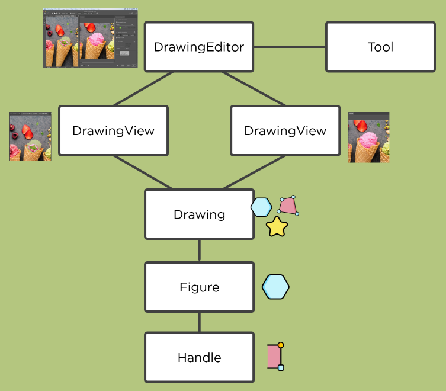

# Software Design Laboratory Class

**⚠️ IMPORTANT NOTE:** This repository will be **deleted** at the end of the course. Make sure to save any code you want to keep elsewhere.


## ✏️ Additional Instructions

### Getting JHotDraw

To download JHotDraw 5.1, choose one of the following options:
- [Download the zip](https://github.com/org-raul-ds/12_MyJHotdraw_zip/archive/refs/heads/main.zip) file and unzip it.
- Clone the repository using the command:
    ```bash
    git clone https://github.com/org-raul-ds/12_MyJHotdraw_zip.git
    ```

## 📚 Main JHotDraw Interfaces



## 🔧 Class Resources

### Fragment 1. `ExampleFigure.java`

```java
public void draw(Graphics g) {
	g.setColor(java.awt.Color.WHITE);
	g.fillRect(0,0,100,100);
}

public Rectangle displayBox() {
	return new Rectangle(0,0,100,100);
}

public Vector handles() {
	return new Vector();
}
```

### Fragment 2. `NothingApp.java`

```java
protected void createTools(Panel palette) {

	super.createTools(palette);

	Tool myTool = new ExampleTool(view());

    palette.add(createToolButton(IMAGES + "RECT", "Example Tool", myTool));
}
```

## 💻 Submission Instructions

To submit your solution:
- Open the terminal.
- Navigate to the folder where this `README.md` file is located.
- Run `git add -A`.
- Run `git commit -m "final code"`.
- Run `git push`.
